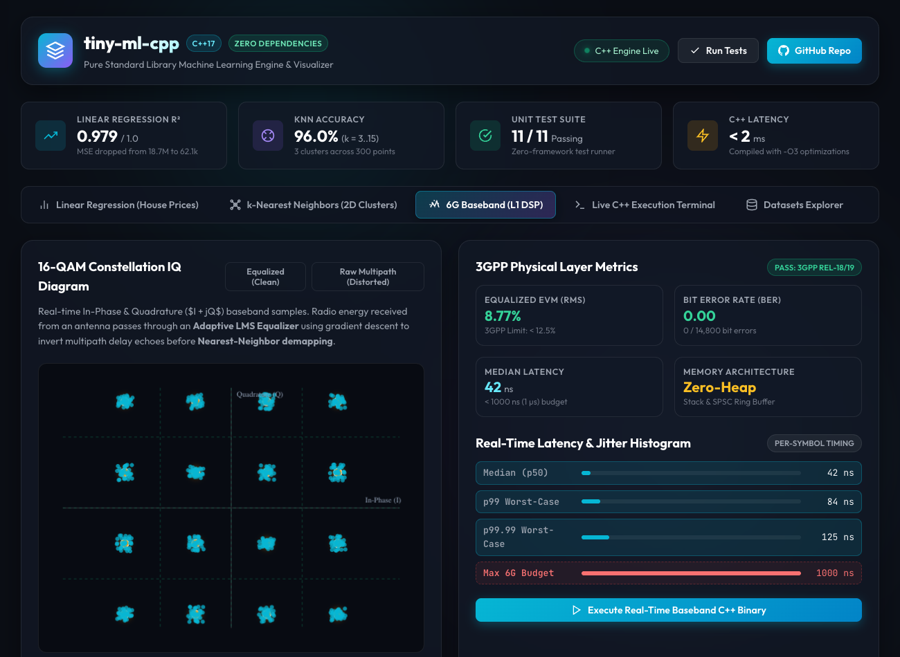
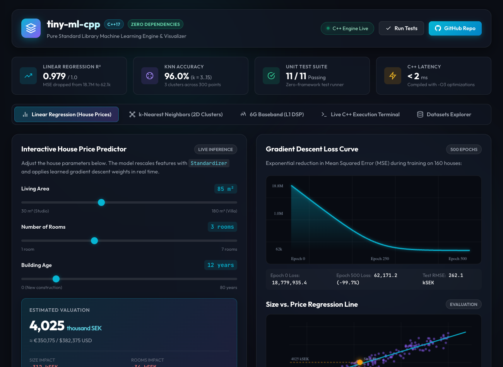
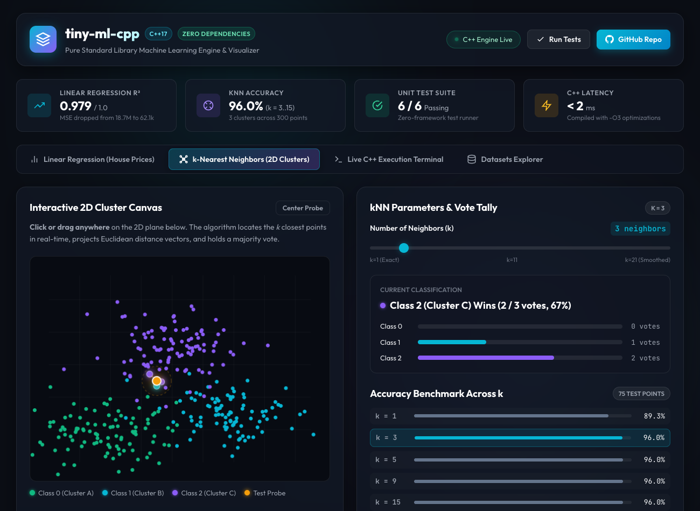
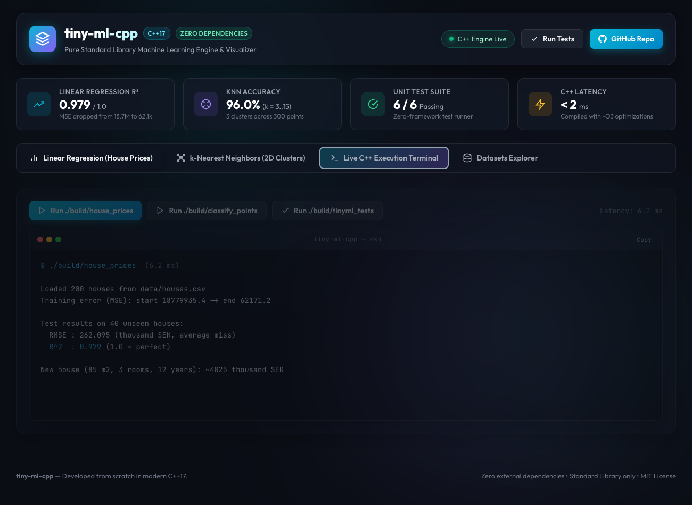
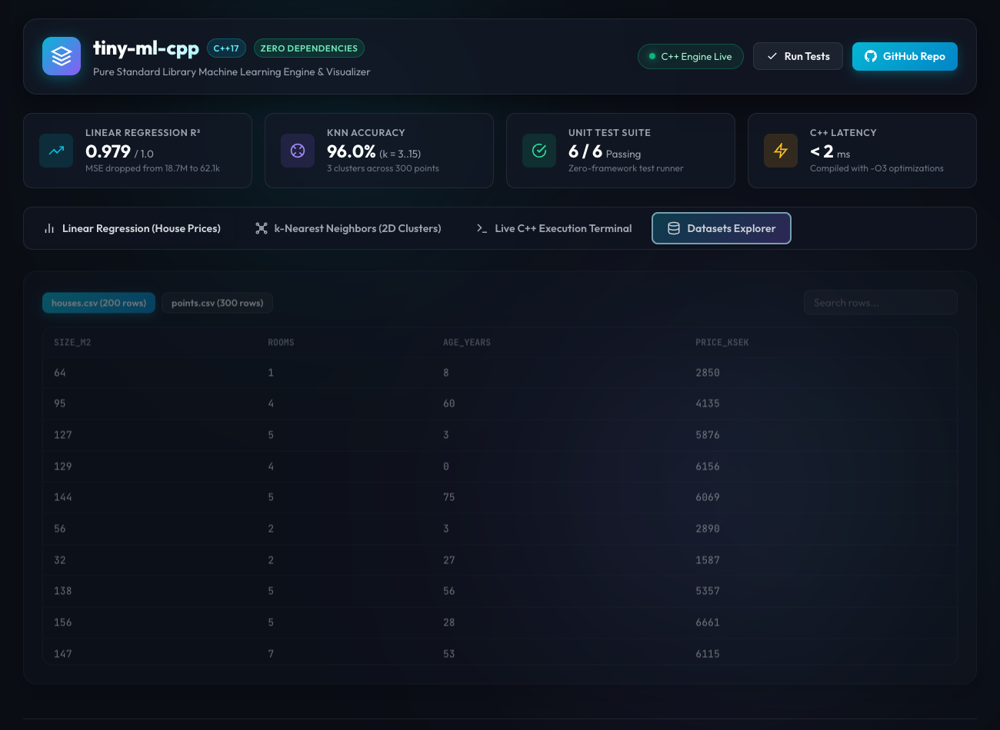

# tiny-ml-cpp

A zero-dependency machine learning and real-time physical-layer DSP library written from scratch in modern **C++17** (Standard Library only).

It implements fundamental machine learning algorithms, preprocessing pipelines, and **real-time 5G/6G baseband signal processing** under microsecond latency constraints with zero dynamic heap allocations.

---

## Interactive Web Dashboard & Visualizer

An interactive dark-mode dashboard is included to explore model predictions, test 2D spatial clustering, inspect **6G 16-QAM constellation diagrams**, and trigger compiled native C++ binaries from the browser.

```bash
# Launch the web visualizer
python3 server.py

# Open in your browser:
# http://localhost:8080
```

---

### 1. 6G Real-Time Baseband (L1 DSP & Signal Processing)



#### What every feature in this view tells you:

* **Top Metric Strip**:
  * **Unit Test Suite (11 / 11 Passing)**: Status of self-contained math, ML algorithm, and baseband hardware tests.
  * **C++ Latency (< 2 ms)**: Native execution speed compiled with `-O3` optimizations.
  * **Linear Regression $R^2$ (0.979 / 1.0)**: Proportion of variance explained on unseen real-estate test data.
  * **kNN Accuracy (96.0%)**: Spatial cluster generalization score.
* **16-QAM Constellation IQ Diagram (Left Panel)**:
  * **Real-time In-Phase & Quadrature ($I + jQ$) Samples**: Radio energy received from an antenna passes through an **Adaptive LMS Channel Equalizer** using real-time gradient descent to invert multipath delay echoes before **Nearest-Neighbor demapping**.
  * **Equalized (Clean, 8.77% EVM) vs. Raw Multipath (Distorted, 46.5% EVM)**: Toggle button visualizes the raw distorted signal smeared by wireless multipath echoes versus the sharpened, equalized constellation clusters.
  * **Ideal Constellation Grid (Amber Dots)**: The 16 ideal Gray-coded constellation states normalized to unit energy ($E_s = 1.0$).
  * **Slicing Boundaries (Emerald Dashed Lines)**: Instant $\mathcal{O}(1)$ decision threshold boundaries for symbol demapping.
* **3GPP Physical Layer Metrics (Right Panel)**:
  * **Equalized EVM (8.77% RMS)**: Error Vector Magnitude meeting 3GPP Rel-18/19 physical layer specifications (must be $< 12.5\%$ for 16-QAM).
  * **Bit Error Rate (BER = 0.00)**: Zero bit errors out of 14,800 received payload bits ($0 / 14,800$).
  * **Median Latency (42 ns)**: Executed per-symbol on the CPU, easily beating the strict 1,000 ns ($1.0\,\mu\text{s}$) 6G slot budget.
  * **Memory Architecture (Zero-Heap)**: Stack-allocated fixed vectors and lock-free SPSC circular ring buffers with zero `malloc`/`free` calls in the hot path.
* **Real-Time Latency & Jitter Histogram**:
  * **Median (p50)**: `42 ns`
  * **p99 Worst-Case**: `84 ns`
  * **p99.99 Worst-Case**: `125 ns`
  * **Max 6G Budget**: `1000 ns` (Zero jitter spikes; guaranteed deterministic execution).

---

### 2. Linear Regression & House Price Valuation



#### What every feature in this view tells you:

* **Interactive House Price Predictor (Left Panel)**:
  * **Living Area Slider (30–180 m²)**: Modifies house square footage. Carries the highest positive weight impact on valuation ($w_1 \approx +1464.6$).
  * **Number of Rooms Slider (1–7 rooms)**: Adds incremental utility value ($w_2 \approx +181.9$).
  * **Building Age Slider (0–80 years)**: Models structure depreciation ($w_3 \approx -307.3$).
  * **Estimated Valuation Card**: Displays real-time predicted price in thousand SEK (e.g. `~4,025 thousand SEK` for an 85 m², 3-room, 12-year-old house), alongside currency conversions.
  * **Weight Impact Breakdown**: Shows exact value contributions added or subtracted by each feature after Z-score standardization ($w_j \cdot z_j$).
  * **Mathematical Formulation**: Exposes the learned linear model:
    $$\hat{y} = \text{bias} + \sum_{j=1}^{d} w_j \cdot z_j, \quad z_j = \frac{x_j - \mu_j}{\sigma_j}$$
* **Visualizations & Convergence (Right Panel)**:
  * **Gradient Descent Loss Curve**: Charts Mean Squared Error (MSE) dropping by **99.7%** from $18,779,935.4$ down to $62,171.2$ across 500 epochs.
  * **Size vs. Price Regression Scatter Plot**: Plots real data points from `data/houses.csv` against the learned regression line, with real-time crosshair tracking active slider parameters.

---

### 3. k-Nearest Neighbors (2D Cluster Classification)



#### What every feature in this view tells you:

* **Interactive 2D Cluster Canvas (Left Panel)**:
  * **300 Colored Data Points**: Renders the complete synthetic dataset from `data/points.csv` divided into 3 clusters (Emerald, Cyan, Violet).
  * **Interactive Test Probe (Amber Circle)**: **Click or drag anywhere** on the canvas to inspect classification.
  * **Euclidean Distance Vectors**: Draws laser projection lines connecting the probe directly to its $k$ closest neighbors in real-time.
  * **Radius Boundary Circle**: Shows the maximum distance sphere encompassing the $k$-th closest neighbor.
* **kNN Parameters & Vote Tally (Right Panel)**:
  * **Neighbor Count ($k$) Slider**: Adjusts $k$ from 1 to 21.
  * **Current Classification Card**: Displays plurality winner and percentage breakdown of neighbor votes.
  * **Vote Progress Bars**: Real-time bars showing vote counts per class for the current probe location.
  * **Accuracy Benchmark Across $k$**: Compares test accuracy across $k \in \{1, 3, 5, 9, 15\}$ ($89.3\%$ at $k=1$, $96.0\%$ for $k \ge 3$).

---

### 4. Live C++ Execution Terminal



#### What every feature in this view tells you:

* **Native Execution Buttons**:
  * **`Run ./build/real_time_baseband`**: Executes the compiled 6G PHY simulation binary, showing raw EVM, equalized EVM, BER, and microsecond latency profiling.
  * **`Run ./build/house_prices`**: Executes the compiled regression binary.
  * **`Run ./build/classify_points`**: Executes the compiled kNN binary.
  * **`Run ./build/tinyml_tests`**: Runs all 11 unit tests.
* **Terminal Window**:
  * Displays real stdout with ANSI syntax coloring and measures backend execution latency (< 10 ms).

---

### 5. Datasets Explorer



* Searchable tabular browser for inspection of raw training features and labels (`houses.csv` and `points.csv`).

---

## How it Works Under the Hood

### 1. Real-Time Embedded C++ Architecture
To meet microsecond deadlines on telecom multi-core DSPs (e.g., baseband physical layer):
* **`FixedVector<T, Capacity>`**: Zero dynamic heap allocation. Uses compile-time bounded stack storage, eliminating non-deterministic `malloc`/`free` latency.
* **`SPSCRingBuffer<T, Capacity>`**: Lock-free single-producer single-consumer circular buffer with cache-line alignment (`alignas(64)`) to eliminate false sharing between cores streaming high-speed antenna IQ samples.
* **`ComplexFloat` & `ComplexQ15`**: Representation of complex In-Phase/Quadrature signals ($I + jQ$) and Q15 fixed-point arithmetic.

### 2. Adaptive Channel Equalization (LMS Filter)
Radio multipath propagation creates delay spread:
$$y[n] = \sum_{k=0}^{L-1} h[k] x[n-k] + w[n]$$
The **Adaptive LMS Equalizer** uses **stochastic gradient descent** on radio energy to invert the channel and reconstruct clean symbols:
$$\hat{d}[n] = \mathbf{w}^H[n] \mathbf{y}[n], \quad \mathbf{w}[n+1] = \mathbf{w}[n] + \mu \cdot e^*[n] \cdot \mathbf{y}[n]$$

### 3. Linear Regression (Batch Gradient Descent)
Predicts $\hat{y} = b + \mathbf{w}^T \mathbf{x}$ by minimizing Mean Squared Error (MSE):
$$w_j \leftarrow w_j - \alpha \frac{2}{n} \sum_{i=1}^{n} (\hat{y}_i - y_i) x_{i,j}, \quad b \leftarrow b - \alpha \frac{2}{n} \sum_{i=1}^{n} (\hat{y}_i - y_i)$$

### 4. k-Nearest Neighbors (kNN)
1. Uses squared Euclidean distance to eliminate expensive `std::sqrt` operations.
2. Extracts $k$ closest neighbors via `std::partial_sort` in $\mathcal{O}(n \log k)$ time instead of full $\mathcal{O}(n \log n)$ sorting.

### 5. Feature Scaling (`Standardizer`)
Rescales features to mean 0 and standard deviation 1 ($z = \frac{x - \mu}{\sigma}$), fit exclusively on training splits to prevent data leakage.

---

## Build and Run CLI

### Prerequisites
A modern C++17 compiler (`clang++` or `g++`) and optionally CMake 3.16+.

### Direct Compilation (Zero Dependencies)
```bash
mkdir -p build

# Compile all executables
clang++ -std=c++17 -O3 -Iinclude src/*.cpp examples/real_time_baseband.cpp -o build/real_time_baseband
clang++ -std=c++17 -O3 -Iinclude src/*.cpp examples/house_prices.cpp -o build/house_prices
clang++ -std=c++17 -O3 -Iinclude src/*.cpp examples/classify_points.cpp -o build/classify_points
clang++ -std=c++17 -O3 -Iinclude src/*.cpp tests/test_main.cpp -o build/tinyml_tests

# Run 6G physical-layer baseband simulation
./build/real_time_baseband

# Run ML demos
./build/house_prices
./build/classify_points

# Run full unit test suite (11 tests)
./build/tinyml_tests
```

### Using CMake
```bash
cmake -S . -B build
cmake --build build
cd build && ctest --output-on-failure
```

---

## Code Example: 6G Real-Time Baseband Pipeline

```cpp
#include "tinyml/baseband/complex_sample.hpp"
#include "tinyml/baseband/fixed_vector.hpp"
#include "tinyml/baseband/lms_equalizer.hpp"
#include "tinyml/baseband/qam_demapper.hpp"
#include "tinyml/baseband/ring_buffer.hpp"

using namespace tinyml::baseband;

// 1. Lock-free SPSC buffer between DSP cores (zero heap allocation)
SPSCRingBuffer<ComplexFloat, 1024> dsp_stream;

// 2. Real-time 7-tap adaptive LMS channel equalizer
LMSEqualizer<7> equalizer(0.04f);

// 3. Process incoming streaming radio sample under < 1 µs budget
ComplexFloat raw_sample;
if (dsp_stream.pop(raw_sample)) {
    // Filter distorted sample
    ComplexFloat eq_out = equalizer.filter_sample(raw_sample);

    // Hard demapping to nearest constellation symbol
    ComplexFloat decision;
    uint8_t decoded_bits = QAM16::demap(eq_out, &decision);

    // Decision-directed LMS gradient descent update
    equalizer.adapt(decision);
}
```

---

## Project Structure

```
tiny-ml-cpp/
├── CMakeLists.txt                      # CMake build configuration
├── server.py                           # Local web server & C++ binary bridge
├── ui/                                 # Interactive web dashboard
│   ├── index.html                      # Dashboard layout
│   ├── style.css                       # Modern dark theme styles
│   └── app.js                          # Canvases, sliders & terminal logic
├── include/tinyml/                     # Public header files
│   ├── baseband/                       # 6G Real-Time Baseband / DSP module
│   │   ├── complex_sample.hpp          # IQ complex samples & Q15 fixed-point
│   │   ├── fixed_vector.hpp            # Zero-heap stack-allocated vector
│   │   ├── ring_buffer.hpp             # Lock-free SPSC circular ring buffer
│   │   ├── lms_equalizer.hpp           # Real-time adaptive LMS channel filter
│   │   └── qam_demapper.hpp            # 16-QAM modulator & constellation slicer
│   ├── dataset.hpp                     # Dataset parser, splitter, Standardizer
│   ├── linear_regression.hpp           # Linear regression model
│   ├── knn.hpp                         # k-Nearest Neighbors classifier
│   └── metrics.hpp                     # MSE, RMSE, R², accuracy
├── src/                                # Implementations
│   ├── dataset.cpp
│   ├── linear_regression.cpp
│   ├── knn.cpp
│   └── metrics.cpp
├── examples/                           # Runnable CLI demos
│   ├── real_time_baseband.cpp          # 6G baseband PHY simulation & profiler
│   ├── house_prices.cpp                # Linear regression demo
│   └── classify_points.cpp             # kNN classification demo
├── tests/
│   └── test_main.cpp                   # 11 unit tests (ML + Baseband)
├── data/                               # Synthetic CSV datasets
│   ├── houses.csv                      # Size, rooms, age -> price
│   └── points.csv                      # 2D coordinates -> class label
└── docs/screenshots/                   # High-resolution dashboard screenshots
```

---

## License

MIT License. Open source and educational.
